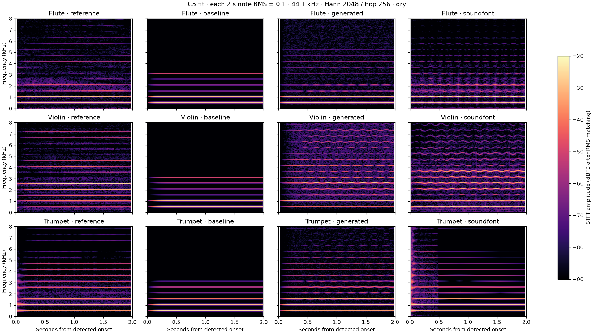
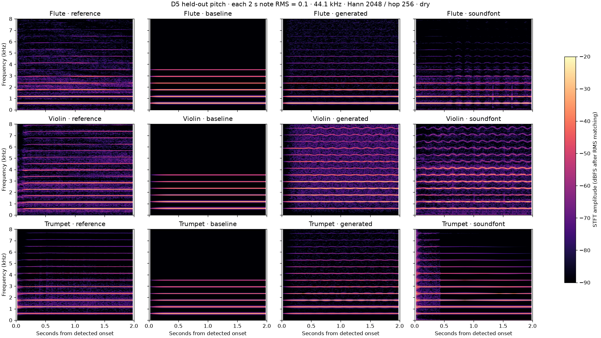

# Measured scores and generated instrument timbres

Study revision 0.1, 21 October 2026. Composer **4**, rules **0.3.0**. These measurements describe the exact files in the source manifests, not authoritative reconstructions of the original recordings. No copyrighted song MIDI, lyrics or reference instrument recordings are distributed in this repository. Original generated tones are available in the app's **SoundFonts → Generate an instrument** experiment.

## What was actually examined

We downloaded and parsed thirteen Standard MIDI Files and compared their note events with eight generated genre arrangements, seed 42, each with a 210-second ceiling and its genre's tempo/ensemble defaults. The classical references are score-derived Mutopia editions. The popular references are public MIDI arrangements with unverified transcription provenance; some substantially simplify or change instrumentation. They are evidence about those arrangements, not master-session data or measurements of the artists' performances.

The exact download URLs, byte counts and SHA-256 hashes are in [the MIDI manifest](../tools/research/midi-sources.json). The [complete aggregate results](research/midi-metrics.json) include track/channel ranges, durations, velocities, tempo/meter events and two-bar pattern counts. The raw downloaded files remain local research inputs. The first Alanis file failed strict MIDI parsing and was rejected; the manifest identifies the replacement, which parsed without clipping invalid bytes.

| Reference file | Pitched notes | Pitched track/channel parts | Distinct tempo values | Variation in note density* | What to investigate in our model |
|---|---:|---:|---:|---:|---|
| [Bach, Invention No. 1 BWV 772](https://www.mutopiaproject.org/ftp/BachJS/BWV772/bach-invention-01/) | 458 | 2 | 1 | 0.171 | Two active voices exchange and transform material. Develop imitation, sequence and voice independence rather than adding pad layers. |
| [Mozart, K545 first movement](https://www.mutopiaproject.org/cgibin/piece-info.cgi?id=998) | 1,288 | 2 | 1 | 0.186 | Contrast melody/accompaniment functions, scalar passagework and local tonal destinations; an eight-bar pop form cannot stand in for sonata form. |
| [Debussy, Clair de lune](https://www.mutopiaproject.org/cgibin/piece-info.cgi?id=1778) | 1,468 | 2 | 1 | 0.440 | The file records 9/8, a MIDI range of 27–97 and varied durations. Add compound grouping, register trajectories, harmonic spans and pedalling/articulation. Its fixed MIDI tempo is not evidence against rubato in performances. |
| [Queen, Bohemian Rhapsody arrangement](https://bitmidi.com/bohemian-rhapsody-1-mid) | 4,073 | 14 | 16 | 0.668 | The file contains 2/4, 4/4 and 5/4 events. Support sections with different tempo/metre/texture and transitions, rather than cycling one groove. |
| [Beatles, Hey Jude arrangement](https://bitmidi.com/hey-jude-1-mid) | 2,559 | 3 | 1 | 0.148 | A reduced melody/bass/piano arrangement omits much recording detail. Study recurrent refrain material and a developing coda; this file alone cannot measure the recording's ensemble growth. |
| [Pink Floyd, Shine On You Crazy Diamond arrangement](https://bitmidi.com/pink-floyd-shine-on-you-crazy-diamond-mid) | 5,509 | 15 | 21 | 0.506 | Sparse entrances, long gates and time for recall suggest staged arrivals, sustained colour and deliberate space. File metadata identifies Parts I–V; transcription fidelity is unverified. |
| [Alanis Morissette, You Oughta Know arrangement](https://bhs.minor9.com/midi/assortment/A-F/) | 1,428 | 4 | 1 | 0.474 | The vocal-labelled part has 45 distinct two-bar fingerprints across 54 occupied windows. Broaden rhythmic phrase vocabulary and stress/answer relationships. Every note has one velocity: the file does not capture the singer's dynamic delivery. |
| [Bon Jovi, Livin' on a Prayer arrangement](https://bitmidi.com/bon-jovi-livin-on-a-prayer-k-mid) | 5,574 | 13 | 1 | 0.324 | Model repeated hook roles, preparation and register/tonal lift. Several parts are duplicated in this arrangement; its polyphony is not an orchestration target. |
| [ABBA, Dancing Queen arrangement](https://bitmidi.com/abba-dancing-queen-k-mid) | 1,991 | 5 | 1 | 0.197 | The file has 118 quantised gate-duration bins versus our pop example's 17. Investigate pickups, sustained arrivals, differing accompaniment articulation and hook presentation. This count does not prove catchiness. |
| [In the Mood arrangement](https://bitmidi.com/g-miller-in-the-mood-mid) | 5,203 | 7 | 1 | 0.267 | Recurring riff/answer patterns can coexist with changing bass/voicings. This file includes steel-guitar/soprano-sax labels: it must not be treated as Glenn Miller's original big-band score. |
| [Rednex, Cotton Eye Joe arrangement](https://bitmidi.com/r-nex-cotton-eye-joe-mid) | 4,709 | 12 | 1 | 0.411 | Several parts reuse relatively few two-bar patterns. Preserve dance identity while changing entrances and intensity. This is a Rednex-labelled arrangement, not a source for every traditional Cotton-Eyed Joe variant. |
| [Daft Punk, Around the World excerpt](https://bitmidi.com/daft-punk-around-the-world-mid) | 191 | 3 | 1 | 0.024 | Only 49 quarter-note beats: useful for interlocking repetitive parts, unsuitable for whole-song form conclusions. This supplements the earlier Get Lucky recording study; it is a different work. |
| [The Cure, A Forest arrangement](https://bitmidi.com/the-cure-forest-mid) | 1,277 | 5 | 2 | 0.671 | The bass-labelled part repeats 10 fingerprints across 90 occupied windows. A persistent identity can sit under substantial changes elsewhere; support subtractive endings and role-specific persistence. |

*Density variation is the coefficient of variation of pitched note-on counts in non-overlapping windows of twice the initial bar length. It ignores drums. It is not a musical-quality score. Where meter changes, these remain fixed-duration windows, not correctly relabelled later bars. Incomplete final windows are excluded. Note gates ignore sustain-pedal extensions; simultaneous notes are counted individually. Fingerprints quantise onset to an eighth of a quarter beat, retain absolute pitch and ignore velocity/gate. Different quantisation changes the counts.*

Bach and Mozart editions retain their credited CC BY-SA 3.0 terms; the Debussy edition is marked public domain. Public availability of the other files does not establish a redistribution licence. We publish source identities and derived summaries, not those note sequences. The Axis of Awesome medley is not included in this corpus; selectable I–V–vi–IV harmony is already implemented, but studying that chord schema does not analyse the medley's melodies or performance.

## What our generated notes are missing

The generated pop example contains 1,151 pitched notes, four pitched parts, MIDI range 36–69, 17 quantised gate-duration bins and density variation 0.093. Its lead has 15 two-bar fingerprints across 69 occupied windows; its bass has nine. These figures are consistent with repeated templates, though they do not distinguish useful recall from tedious repetition by themselves.

The orchestral preset contains twelve pitched layers and mean written polyphony 13.10, yet density variation is only 0.159. Its range is 36–71. Adding instruments therefore did not create a convincing orchestral journey: many parts still share pattern families and constrained registers. The Debussy file, for comparison, spans 27–97 with mean written polyphony 4.36. That is a contrast between these examples, not a requirement to make every song cover six octaves.

The concrete priorities are:

1. **Independent phrase roles and actual-rest answers (R02/R06, #8/#19).** Keep a hook recognisable, while bass, answer and accompaniment have their own phrase plans. Give a response access to the actual lead's occupied intervals. Build original comparison examples before choosing defaults.
2. **Harmonic time and destination (R04, #9).** Held chords, changes inside a bar, suspensions with resolution, pedal points and local keys. A named cycle currently still produces one chord event per bar; a twelve-chord blues list inside an eight-bar section does not realise a full twelve-bar blues.
3. **Functional forms and activity arcs (R03/R08, #20).** Introduce, withhold, recall and withdraw roles; permit prechoruses, breakdowns, suites and evolving codas. More note density is an option, not a universal improvement.
4. **Metre and performance (R05/R07/R09, #10/#16/#17).** Compound grouping, instrument-specific gates/transitions, breath/bow plans and phrase-shaped timing. Score-export tempo/velocity values must not be mistaken for measured human expressivity.
5. **Selection and listening (R01/R13, #37).** Compare multiple original hooks, auditioned alone and with backing. No corpus statistic establishes that a new melody is as appealing as an ABBA hook.

The immediate form fix is implemented in composer 4: intro and bridge/break are each **four bars**. The bridge follows a complete verse/chorus pair near two-thirds of the available body, reserving its four bars plus a complete eight-bar chorus return. It moves later as the song's available body grows; this is a product default, not a claim about every reference work. Very short ceilings omit an intro that cannot fit four bars, and omit a break that cannot fit after two complete pairs. The outro retains priority. Intro variation still controls teaser/build decisions, not section length. Existing saved notes continue to replay; settings-only generation uses the new form. Both legacy golden fixtures remain unaffected by this independent arranger version.

## Timbre experiment: generated waves, recorded reference, sampled bank

The app's existing song renderer uses **GeneralUser GS 2.0.3 by S. Christian Collins** through MeltySynth. We did not create those recorded samples. This study compares three different sources:

- Real flute, arco violin and trumpet recordings from the [University of Iowa MIS](https://theremin.music.uiowa.edu/MIS.html), which explicitly permits unrestricted project use. Source labels are non-vibrato mf flute/trumpet and mf violin on the A string. Performer, instrument and recording-chain details remain on the linked source pages in [the manifest](../tools/research/instrument-sources.json).
- Dry GeneralUser presets: flute 73, violin 40, trumpet 56 (zero-based GM), velocity 90, bank SHA-256 `9575028C7A1F589F5770FCCC8CFF2734566AF40CD26ED836944E9A5152688CFE`. Reverb and chorus are disabled.
- Our new **sample-free additive/noise synthesizer**, plus a deliberately simple six-harmonic geometric-rolloff baseline. The baseline represents the old synthesis architecture's limitation; it is not an exact export of every old voice's PCM.

The new generator exposes separate attack/sustain harmonic amplitudes, register anchors, spectral transition time, amplitude attack/release, harmonic tilt, coloured-noise amount/corner, velocity brightness, vibrato depth/rate/delay and slow pitch drift. It integrates pitch continuously and drops harmonics above its bandwidth limit. No instrument recording is replayed, looped or embedded. The numerical spectral coefficients are measured features; noise/vibrato/drift/transition settings are currently design values rather than fitted estimates of the reference performer.

Four spectral anchors per instrument were fitted from C5/E5/G5/B5; **D5 was not fitted**. The first C5-only experiment exposed poor violin extrapolation, prompting the register model. D5 has been inspected during development, so it is a diagnostic interpolation check, not a pristine blind test set. A future evaluation needs different pitches, dynamics, articulations and performers that were not used during development. Pitches outside C5–B5 clamp to the nearest spectrum: the keyboard's wider range is exploratory, not validated orchestral accuracy.

### Spectrograms and numerical results

Each panel covers the first two seconds after an RMS-threshold onset; each note is independently RMS-matched to 0.1. All signals use 44.1 kHz, a 2,048-sample Hann window, 256-sample hop and the same −90 to −20 dBFS amplitude colour scale, plotted to 8 kHz. Reference instruments have different natural tuning and transient structure; onset alignment is approximate. The violin/trumpet recordings sustain longer than two seconds: these plots do not compare their natural releases. No claim of equal perceived loudness follows from RMS matching.

The distance below is L1 distance between amplitude-normalised vectors of the first 24 harmonic bands in the 0.3–1.3 s sustain, using a locally estimated fundamental. Zero means matching this one summary; it is **not** a perceptual similarity score. Pitch estimation, band width, noise leakage and vibrato affect it. The [full measurements](research/timbre-metrics.json) retain frequency estimates and spectral centroids.

| Instrument / note | Simple baseline | Generated | GeneralUser |
|---|---:|---:|---:|
| Flute C5, fitted | 0.1292 | 0.0936 | 0.2818 |
| Violin C5, fitted | 0.8748 | 0.1885 | 0.7522 |
| Trumpet C5, fitted | 0.6421 | 0.0793 | 0.2639 |
| Flute D5, unfitted | 0.3101 | 0.4019 | 0.7117 |
| Violin D5, unfitted | 0.6483 | 0.4731 | 0.4541 |
| Trumpet D5, unfitted | 0.5780 | 0.1136 | 0.1225 |

The generated model improves the fitted-note harmonic summaries; much of that is expected because those spectra supplied its coefficients. Violin/trumpet improve over the simple baseline at D5, while **flute gets worse**. GeneralUser's violin is slightly closer at D5 by this metric. These mixed results justify register-dependent modelling and more measurements, not a declaration that generated instruments now equal real ones or outperform a sampled library overall.

The spectrograms expose further missing behaviour: independent partial envelopes and phase/noise structure, nonlinear excitation across dynamics, body resonances tied to absolute frequency, onset pitch settling, bow/reed/breath articulations and connected-note transitions. Next steps should fit these against multiple dynamics and withheld recordings, then test level-matched phrases in blinded reference/generated comparisons. Long sustained tones are only one condition. “Indistinguishable” remains an aspiration requiring listener evidence and a defined context; it has not been achieved or demonstrated here.

This direction has a research foundation: Serra and Smith's [1990 spectral modelling synthesis paper](https://mtg.upf.edu/node/251) separates time-varying sinusoidal components from a filtered stochastic residual. Our present two-stage harmonic model and single-colour noise are a much simpler experiment; implementing independent partial trajectories and a measured, time-varying residual is substantive work still to do, not functionality supplied by citing that paper.

## Reproduce and listen

See [the research tools](../tools/research/README.md). Scripts verify reference hashes, retain downloads locally and regenerate the summaries/plots. The new `OrchestralSynthesizer` API is dependency-free in the core package; it does not alter legacy synthesis or silently replace sampled studio rendering. The app's SoundFonts lesson provides controls and PDMediaPlayer's native spectrogram for original generated notes. Human listening feedback is still needed; automated event and spectral tests do not establish aesthetic or perceptual success.
